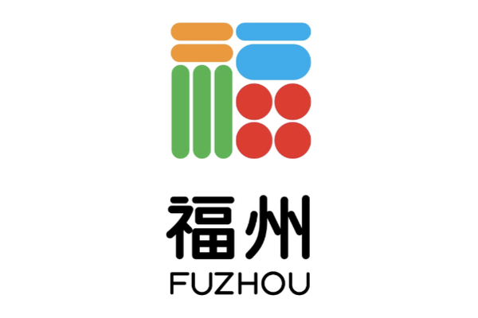

#  Fuzhou rules

Chosen on the welcome and character screens, offered in the online lobby, and
available in the Hand Builder. Fuzhou mahjong (福州麻将, "Gold Rush" mahjong)
is a 16-tile Fujian game with flowers, a flat additive score, and one flipped
tile that is wild.

The source is Mahjong Pros'
[Beginner's Guide to Fuzhou Mahjong](https://mahjongpros.com/blogs/how-to-play/beginners-guide-to-fuzhou-mahjong).
This page summarises what the app implements, and records every place that
guide is silent, unclear or contradicts itself, and what the app does there.

The code lives under `packages/mahjong_core/lib/fuzhou/`. Every shared path
Fuzhou touches is gated on `Ruleset.isFuzhou`. Fuzhou shares the Chinese-style
table flow (`Ruleset.isChineseStyle`): flowers, no riichi, no furiten, nothing
callable off the last discard except to win. Its flag is an image, the city's
福 logo (`Ruleset.flagAsset`, shown by `RulesetFlag`), not an emoji.

## Tiles and play

- **144 tiles**: the three suits, winds and dragons (four of each), and the
  eight flowers and seasons.
- **16-tile hands**; a complete hand is **five sets and a pair** (17 tiles).
  The dealer's first draw is their 17th.
- **Every honor is a flower.** Winds and dragons are flowers along with the
  eight flowers and seasons, 36 in all: a flower is set aside the moment it is
  dealt or drawn and replaced from the tail end of the wall. So a hand holds
  suit tiles only — apart from the Gold (below).
- **The last 18 tiles of the wall are never drawn.** The hand is a draw when
  the rest run out. The dealer flips the last of those 18 as the Gold
  indicator.
- **Calls.** Pung and kong from any seat; chow only from the seat before you.
  A win beats a pung or kong, which beat a chow. Only one seat wins a discard:
  the closest in turn after the discarder.
- **Winning.** There is no minimum score. No riichi and no furiten.
- **Dealer.** The dealer stays only by winning, each consecutive win adding a
  point to their next hand (the *dealer continuation*). A non-dealer win or a
  drawn hand passes the deal.
- **Stakes.** Every seat starts with 500 points (the guide leaves it to the
  table, suggesting 50 or 100; a typical hand moves 20-40 a head, so 500 keeps
  a whole game in play). A full game is eight hands (East and South), practice
  is four.

## The Gold

Once everyone's flowers are replaced, the dealer flips the last of the held-back
tiles. That tile *type* is the **Gold**:

- Every Gold is **wild**: it stands in for any tile in your hand and scores a
  point in a winning hand.
- **How many Golds there are depends on what is flipped.** The flipped tile
  itself is only the face-up indicator, which nobody can hold, so it is never
  one of the Golds:

  | Flipped tile | Which tiles are Gold | How many |
  |---|---|---|
  | A suit tile (say 5 pin) | The other **three** 5 pin | 3 (not 4: the fourth is the indicator) |
  | A wind or dragon (say East) | The other **three** East | 3 |
  | A flower or season (say Plum) | **All the other flowers and seasons**, whatever their number: Orchid, Chrysanthemum, Bamboo, Spring, Summer, Autumn and Winter | 7 (each exists once; the flipped one is the indicator) |

  When a flower or season is flipped, the winds and dragons do **not** become
  Gold: they are flowers in this game, but only the eight flowers and seasons
  count as "the other flowers" here. This is as the guide says ("the other seven
  flowers and seasons"); the code is `FuzhouRules.goldTypesFor`.
- A Gold is **not** exposed as a flower: it stays in hand as a wild, whatever
  it is. (The guide lets a player declare a Gold flower for flower points
  instead; keeping the wild is always worth more, so the app never declares
  one.) A flower that was dealt before the flip was already exposed.
- A Gold **can't be used to chow, pung or kong**, and a discarded Gold **can't
  be claimed by anyone**. A seat that discards a Gold may **only win by
  self-draw** for the rest of the hand.
- **Robbing the Gold (抢金).** The moment the Gold is flipped, before anyone has
  drawn, the first seat in turn from the dealer whose 16 tiles are ready wins
  on it. The Gold is wild, so any ready hand qualifies. It is taken
  automatically, scored as a self-draw (every other seat pays), and worth 50
  extra points. The guide says the Gold must "match the winning tile"; with a
  wild that reads as "any ready hand".

## Scoring

```
payout = ((5 base + flowers + golds + dealer continuation + kongs) x 2)
         + special hands
```

A win on a discard is paid by the discarder alone. A self-draw is paid by each
of the other three, the same amount; there is no dealer premium.

| Line | Points |
|---|---|
| Base | 5 |
| Each flower (winds and dragons included) | 1 |
| Full Bloom: all four flowers, all four seasons, or four of one wind or dragon | +6 each set |
| Each Gold in the winning hand | 1 |
| Dealer continuation | 1 per consecutive win (dealer only) |
| Open kong (including an added kong) | 1 |
| Concealed kong | 2 |

These add up before the doubling. Special hands are added after it:

| Special hand | Points |
|---|---|
| All Sequences (平胡): five sequences and a pair, Golds standing in | 10 |
| One Flower: exactly one flower exposed | 15 |
| Golden Pair (金雀): the pair is two Golds | 20 |
| Three Gold Knockdown (三金倒): three Golds in the winning hand | 30 |
| Golden Dragon (金龙): three Golds as a set of their own | 40 |
| Robbing the Gold (抢金) | 50 |
| Blessing of Earth: a non-dealer wins on the dealer's first discard | 40 |
| Blessing of Heaven: the dealer's self-draw on their first turn | 50 |

Golden Pair, Three Gold Knockdown and Golden Dragon **do not stack**: the
highest that applies counts. The rest add together. Full Bloom stacks with the
single flower points. Heaven is not added on top of Robbing the Gold.

### Where the guide is unclear

- **All Sequences is 10, not 15.** The guide's worked example uses 15 but its
  table says 10; the table wins.
- **Full Bloom is in the doubled part.** It "stacks with individual flower
  points", so it is counted with them, before the doubling.
- **Three Gold Knockdown needs a complete hand.** The guide describes it as "a
  winning hand containing three gold tiles". (In some Fuzhou play, holding all
  three Golds wins outright; the app follows the guide.)
- **Blessing of Earth** reads in the guide as a non-dealer winning "on the first
  draw before any tiles are drawn". The app uses the usual meaning, a win on the
  dealer's first discard.
- **Kong reserve.** The guide reserves extra tiles from the end of the wall for
  each kong. The app does not model a moving reserve: replacements come from
  the tail end of the live wall, and the hand is a draw when it is empty.

## Online and the builder

- **Online.** The server runs the table like any other (`TableLoop`); the Gold
  indicator and each seat's "discarded a Gold" flag are public and go in the
  snapshot (`protocol.dart`). A client that doesn't list `fuzhou` in
  `supportedRulesets` is asked to update.
- **Hand Builder.** *Gold* is a table setting, like the winds: tap **Gold**,
  then the tile that was flipped, and every other tile of that kind in your
  hand is wild. Winds, dragons, flowers and seasons go in the flower area.

## Guide and bots

The guide counts Gold tiles as the wilds they are: each lowers the hand's
shanten by one (`TileEfficiencyCalculator.wildShanten`), and an unseen Gold
counts as an improving draw. The win chance treats each step as drawing to the
current outs, and the payoff counts what the hand has banked (flowers, Golds,
streak, kongs) but not the special hands. It ranks discards; it is not a
calibrated model. The bots take a kong always, a pung or chow when it brings
the hand closer, never throw a Gold unless nothing else is left, and play
shanten, then acceptance.
